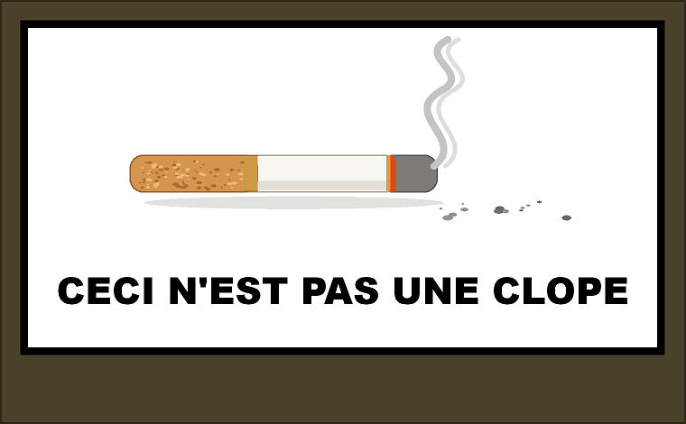

🚬 AntiCroissantage
===================

Un faux bureau verrouillé, pour que personne ne te fasse payer les croissants quand tu quittes ton poste.

Un raccourci clavier photographie ton écran et l'affiche en plein écran, clavier et clics bloqués. Pour un collègue, le PC est juste figé. Toi, tu reviens, tu fais **AltGr + H** et la vraie session Windows se verrouille (mot de passe demandé).

> 🥐 Un projet de blague, pas une sécurité : voir les [limites](#️-limites).



### 📖 Concept du projet

Pour le collègue :

- Ton bureau tel que tu l'as laissé, sur tous les écrans, avec la vraie barre des tâches (l'horloge reste à l'heure).
- Le curseur bouge normalement, mais rien ne répond.
- Un clic fait apparaître un paquet « Ceci n'est pas une clope ». Chaque clic dessus consume la clope un peu plus, avec un nouveau message, et une fumée suit le curseur.
- Le menu Démarrer s'ouvre (c'est un miroir du vrai) et la recherche répond, mais rien ne peut être lancé.

Pour toi, à ton retour : après ton mot de passe, un **tableau de chasse** résume les tentatives (clics, touches, première et dernière heure).

## 🚀 Installation

Il te faut Windows 10 ou 11 (version 2004 minimum) et Python 3. Rien d'autre : le projet n'utilise que `ctypes`.

1. Clone le dépôt.
2. Crée le raccourci sur le Bureau :

   ```powershell
   .\installer-raccourci.ps1
   ```

3. Appuie sur **Ctrl + Alt + L** pour verrouiller. Pour une autre touche : `.\installer-raccourci.ps1 -Touche "CTRL+SHIFT+F12"`.

## 🕹️ Utilisation

| Commande | Effet |
| --- | --- |
| `Ctrl + Alt + L` | Verrouille avec le faux bureau (le raccourci du Bureau) |
| `AltGr + H` | Retire le faux bureau, puis verrouille vraiment Windows |
| `python anticroissantage.py --timeout 20 --nolock` | Test sans risque : se déverrouille seul après 20 s, sans verrouiller la session |

## 🌳 Structure du projet

```
├── anticroissantage.py       # le programme : fenêtres, clavier et souris, menu miroir, tableau de chasse
├── clope.py                  # les dessins : paquet, clope qui se consume, fumée, tableau
├── winapi.py                 # déclarations de l'API Windows (ctypes)
├── installer-raccourci.ps1   # crée le raccourci « Verrouiller » sur le Bureau
└── docs/                     # image du README
```

Quelques repères pour débuter :

- Le faux bureau est une fenêtre par écran, qui affiche une photo prise au verrouillage.
- Les touches et les clics sont interceptés par deux « hooks » Windows : `keyboard_hook` et `mouse_hook`.
- Le menu Démarrer miroir ouvre le vrai menu sous nos fenêtres (exclues des captures d'écran) et en affiche une copie en direct.

## ⚠️ Limites

- **Ctrl + Alt + Suppr** ne peut pas être bloqué : quelqu'un qui connaît ce raccourci sort du faux bureau.
- Le faux bureau est une photo : seules la barre des tâches et le menu Démarrer sont « vivants ».
- Ne l'utilise que sur ton propre poste, entre collègues qui ont de l'humour.

---

Créé pour rigoler à la pause café. 🥐
